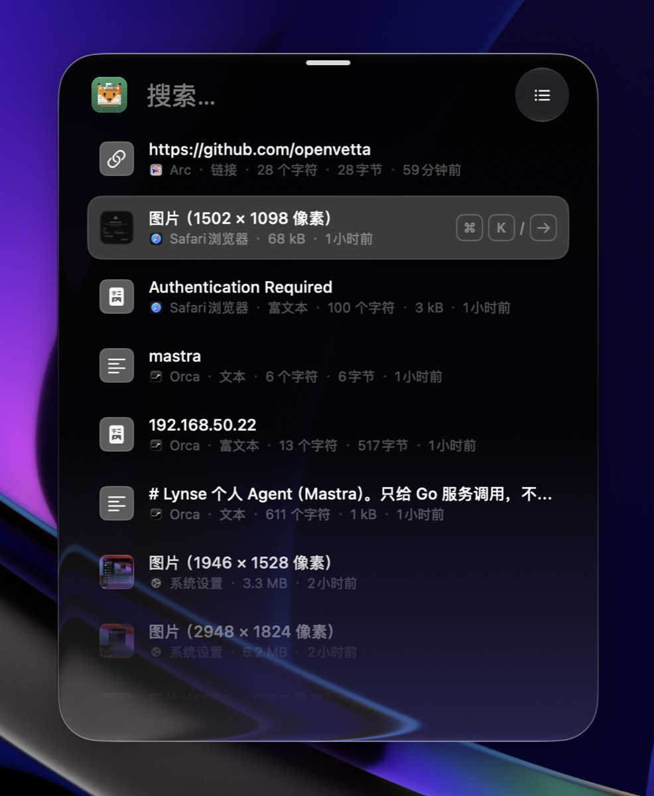
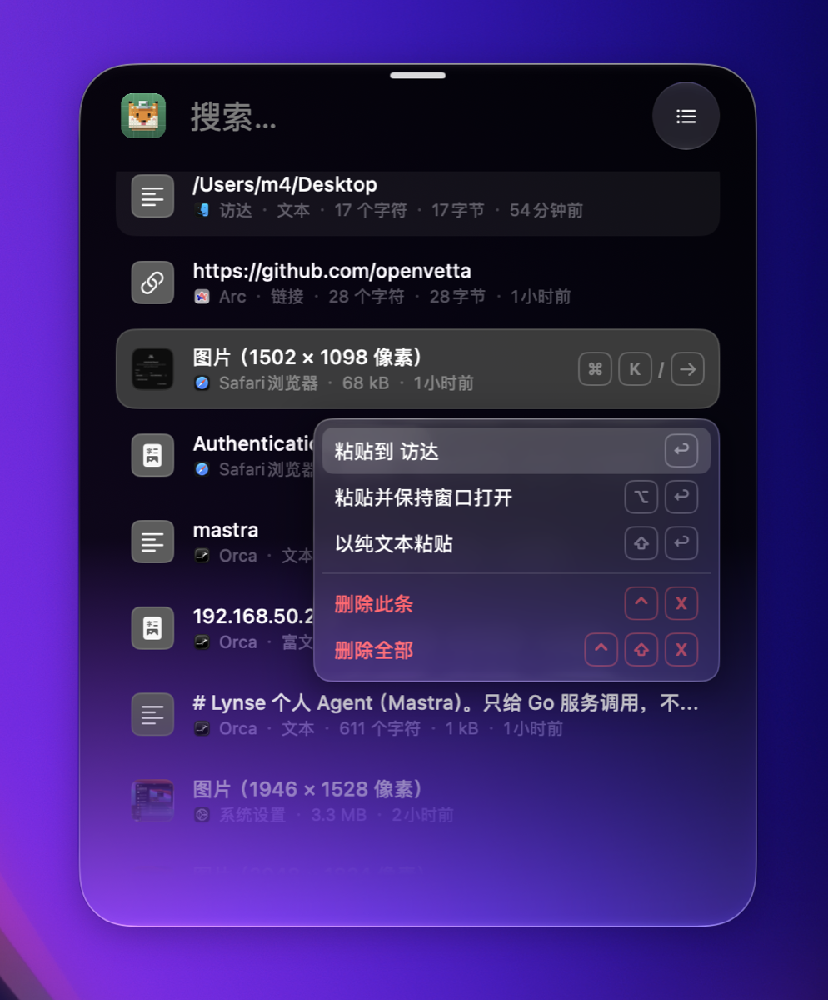
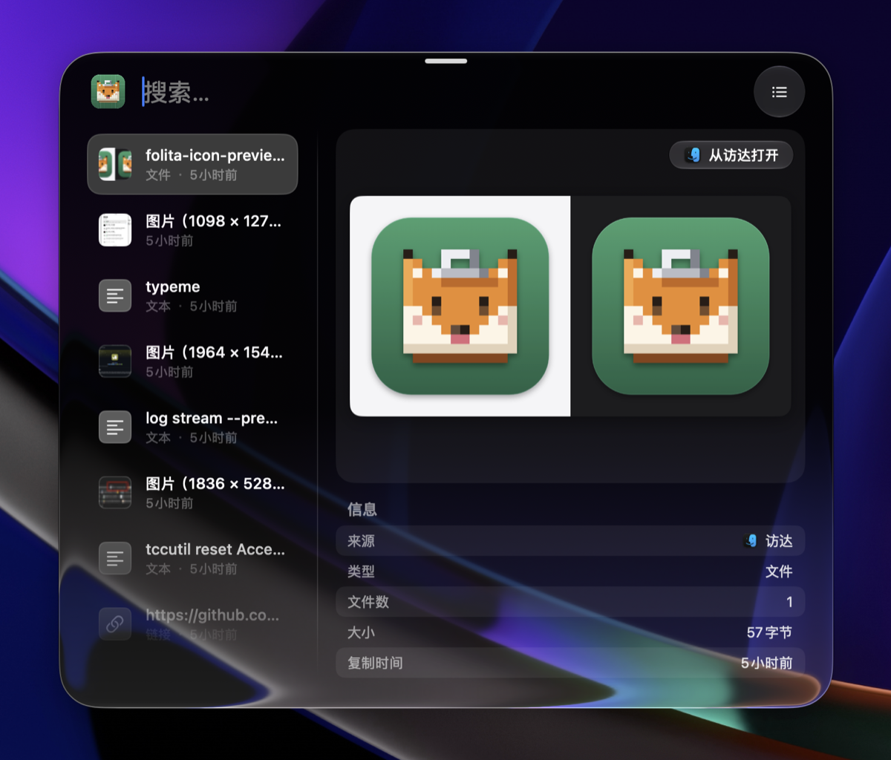
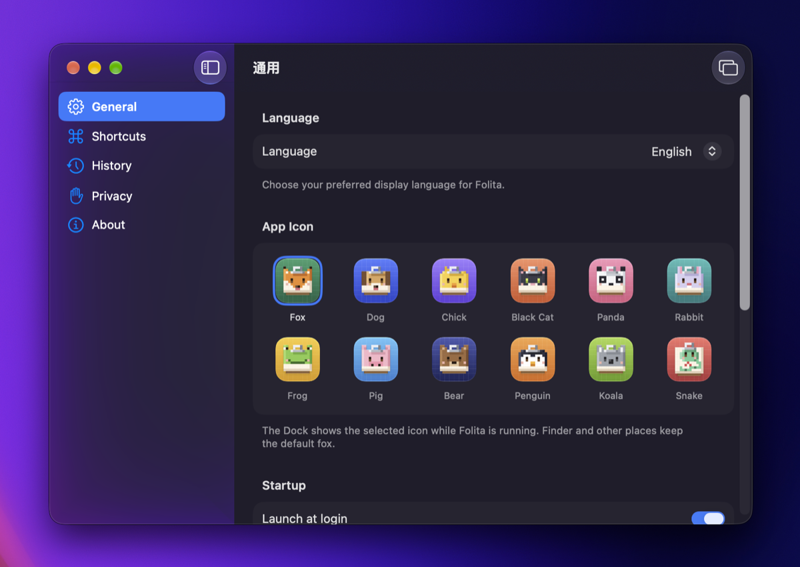

<p align="center">
  
</p>

<p align="center">
  A native macOS clipboard manager with a Liquid Glass panel, written in pure Swift.
</p>

<p align="center">
  English ·
  <a href="README.zh-CN.md">简体中文</a> ·
  <a href="https://github.com/openvetta/folita/releases/latest">Download</a> ·
  <a href="docs/releasing.md">Releasing</a>
</p>

---

Folita keeps what you copy and brings it back with a shortcut. Press <kbd>⌘</kbd><kbd>⇧</kbd><kbd>V</kbd> in any app, pick an item, and it is pasted into the app you came from. It lives in the menu bar only — there is no Dock icon.

## Screenshots

<table width="100%">
  <tr>
    <td width="50%" align="center"><br><sub>Clipboard panel</sub></td>
    <td width="50%" align="center"><br><sub>More actions (<kbd>⌘K</kbd>)</sub></td>
  </tr>
  <tr>
    <td width="45%" align="center"><br><sub>Detail preview</sub></td>
    <td width="55%" align="center"><br><sub>Settings and app icons</sub></td>
  </tr>
</table>

## Features

- **Liquid Glass panel.** A translucent panel pops up from the top of the screen, the center, or at the cursor, in light and dark appearances.
- **Keyboard first.** <kbd>↑</kbd><kbd>↓</kbd> to select, <kbd>↩</kbd> to paste, <kbd>⇧↩</kbd> as plain text, <kbd>⌘1</kbd>–<kbd>⌘9</kbd> for the first nine, <kbd>⌘K</kbd> for more actions.
- **Search and filters.** Text, images, files, links, colors, and emails, with a detail preview for the selected item.
- **Private by default.** History stays on your Mac. Items marked hidden by password managers, items over 10 MB, and apps you ignore are never recorded. Recording can be paused at any time.
- **Sandboxed.** The app runs in the App Sandbox and requests no network access of its own.
- **Extras.** Menu bar only (the Dock icon appears only while settings are open), global shortcut, launch at login, 12 app icons, automatic updates, English and Simplified Chinese.

## Install

Requires macOS 26 or later.

```sh
brew install --cask openvetta/tap/folita
```

Or download the signed and notarized build from [Releases](https://github.com/openvetta/folita/releases/latest).

Auto-paste simulates <kbd>⌘</kbd><kbd>V</kbd> and needs the Accessibility permission. Without it, the item is copied back and you paste it yourself.

## Development

Requires macOS 26+, Xcode 26+, and [XcodeGen](https://github.com/yonaskolb/XcodeGen) (`brew install xcodegen`).

```sh
make project   # generate Folita.xcodeproj
make build     # build Debug
make test      # run tests
make run       # build and launch
make app-icons # re-export icons after editing design/app-icons
```

Builds use ad-hoc signing by default, so no certificate is needed. Maintainers can copy `Configs/Local.xcconfig.example` to `Configs/Local.xcconfig` (git-ignored) and set a team, which keeps the signing identity stable so Accessibility grants survive rebuilds.

To launch a Debug build with the clipboard panel already open:

```sh
open .build/DerivedData/Build/Products/Debug/Folita.app --args -FolitaShowClipboardPanel YES
```

### Layout

```text
Folita/
  App/              Entry point, AppDelegate (wires services), menu bar and its icon, launch at login, app icon
  ClipboardPanel/   Panel window, controller, state model, history list and search
  History/          Pasteboard monitor, capture rules, SwiftData model and store, retention and privacy
  Paste/            Writing back to the pasteboard, auto-paste, permission hints
  HotKey/           Global shortcut (wraps KeyboardShortcuts)
  Updates/          In-app updates (wraps Sparkle)
  MainPanel/        Main window and its settings sections
  DesignSystem/     Siri-style glass container and colors
  Resources/        Localizable.xcstrings (en / zh-Hans), Assets.xcassets (generated icon thumbnails)
FolitaTests/        Swift Testing unit, view, and flow tests
Configs/            Signing configuration (Local.xcconfig is not committed)
design/app-icons/   Icon Composer sources for the selectable app icons
scripts/icons/      Exports icon sources into Assets.xcassets
docs/adr/           Architecture decision records
docs/releasing.md   Release process and required credentials
project.yml         XcodeGen project definition (.xcodeproj is not committed)
```

## License

[MIT](LICENSE) © nbecloud
